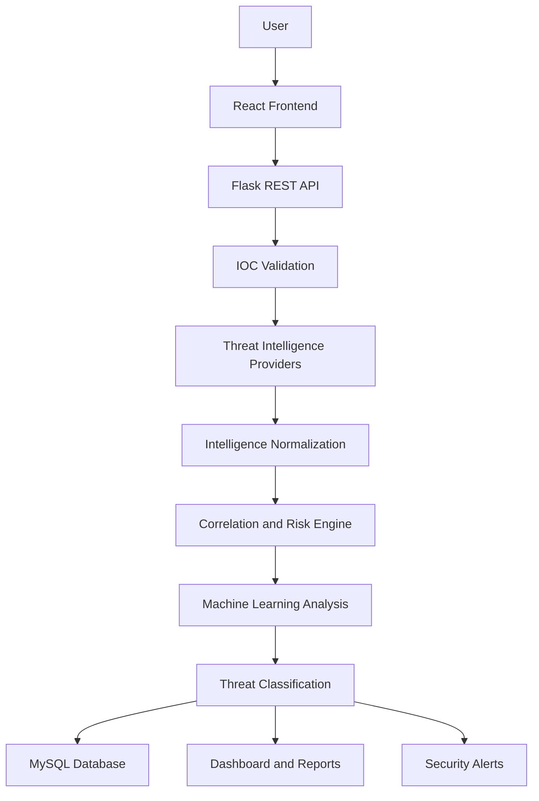

# 🛡️ ThreatLens

### Automated Emerging Cyber Threat Identification

**See the Threat Before It Spreads.**


## Overview

ThreatLens is an AI-powered cybersecurity platform designed to identify, analyze and assess emerging cyber threats by combining threat intelligence, machine learning and automated risk assessment.

The platform consolidates intelligence from multiple security providers into a unified interface, helping users investigate suspicious Indicators of Compromise (IOCs), understand potential threats and make informed security decisions.

## Key Features

- **IOC Scanner:** Investigate suspicious IP addresses, URLs, domains and other supported indicators.
- **Batch Scanning:** Analyze multiple indicators through a unified workflow.
- **AI Threat Analysis:** Machine learning-based threat classification.
- **Risk Assessment:** Automated threat severity evaluation and risk scoring.
- **Threat Intelligence Fusion:** Correlation of intelligence from multiple security providers.
- **Emerging Threat Identification:** Identify recurring indicators and emerging threat patterns.
- **Interactive Dashboard:** Visualize threat statistics and security insights.
- **MITRE ATT&CK:** Threat intelligence contextualization.
- **Security Recommendations:** Actionable guidance based on threat analysis.
- **Automated Alerts:** Email notifications for high-risk threats when configured.
- **Report Generation:** Export security investigation reports.
- **Scan History:** Access previous investigation results.
- **User Authentication:** Account registration, login and protected application routes.

## Threat Intelligence Integrations

| Provider | Purpose |
|---|---|
| VirusTotal | Reputation and malicious indicator analysis |
| AbuseIPDB | IP abuse reputation |
| AlienVault OTX | Community threat intelligence |
| URLhaus | Malicious URL intelligence |
| PhishTank | Phishing URL intelligence |
| Cisco Talos | Threat reputation intelligence |

Provider availability depends on configuration, credentials and external service availability.

## Technology Stack

| Layer | Technologies |
|---|---|
| Frontend | React.js, JavaScript, Tailwind CSS |
| Backend | Python, Flask |
| Database | MySQL, SQLAlchemy |
| Machine Learning | Random Forest, Scikit-learn |
| API Communication | REST APIs |
| Testing | Pytest, SQLite test database |
| Version Control | Git, GitHub |

## System Architecture



## Project Structure

```text
ThreatLens/
├── app/
│   ├── models/
│   ├── routes/
│   ├── services/
│   │   ├── ml/
│   │   └── providers/
│   └── __init__.py
├── frontend/
│   ├── public/
│   ├── src/
│   │   ├── api/
│   │   ├── components/
│   │   ├── context/
│   │   └── pages/
│   └── package.json
├── tests/
│   └── test_backend.py
├── .env.example
├── .gitignore
├── requirements.txt
├── run.py
└── README.md
```

## Installation and Setup

### Prerequisites

- Python
- Node.js and npm
- MySQL
- Git
- API credentials for the required threat intelligence providers

### 1. Clone the Repository

```bash
git clone https://github.com/rahulreddyseelam9/ThreatLens.git
cd ThreatLens
```

### 2. Configure the Backend

```bash
python3 -m venv .venv
source .venv/bin/activate
pip install -r requirements.txt
```

### 3. Configure Environment Variables

```bash
cp .env.example .env
```

Update the `.env` file with your database configuration, application secret and threat intelligence API credentials.

Create the required MySQL database and configure an authorized database user before starting the backend.

Never commit your actual `.env` file or API credentials to GitHub.

### 4. Start the Backend

```bash
python run.py
```

Backend development URL:

```text
http://localhost:5001
```

### 5. Start the Frontend

Open a separate terminal:

```bash
cd frontend
npm ci
cp .env.example .env
npm start
```

Configure the frontend environment variables to match the backend URL.

Frontend development URL:

```text
http://localhost:3000
```

## Testing and Validation

The project has undergone the following local validation:

| Validation | Result |
|---|---|
| Python syntax validation | 46 files passed |
| Backend automated tests | 25 tests passed |
| Frontend production build | Successful |
| Sensitive file exclusions | Verified |

Backend tests use an isolated test environment. Successful tests do not constitute a complete production security audit.

## Security Considerations

- Environment-based credential configuration.
- Sensitive local files excluded through `.gitignore`.
- Authentication-protected application routes.
- IOC input validation.
- Isolated backend testing.
- Configurable threat intelligence integrations.

## Future Enhancements

- Continuous threat monitoring.
- SIEM integration.
- Containerized deployment.
- Automated CI/CD pipelines.
- Expanded threat intelligence coverage.
- Enhanced machine learning explainability.
- Cloud-based deployment.
- Enterprise security integrations.

## Disclaimer

ThreatLens is intended for educational, research and authorized defensive cybersecurity purposes.

Threat intelligence results and machine learning predictions should be independently validated before making critical security decisions.

## Developer

**Seelam Rahul Reddy**

B.Tech — Computer Science and Engineering (Cybersecurity)

Anurag University, Hyderabad, India

GitHub: [rahulreddyseelam9](https://github.com/rahulreddyseelam9)

---

**ThreatLens — See the Threat Before It Spreads.**
